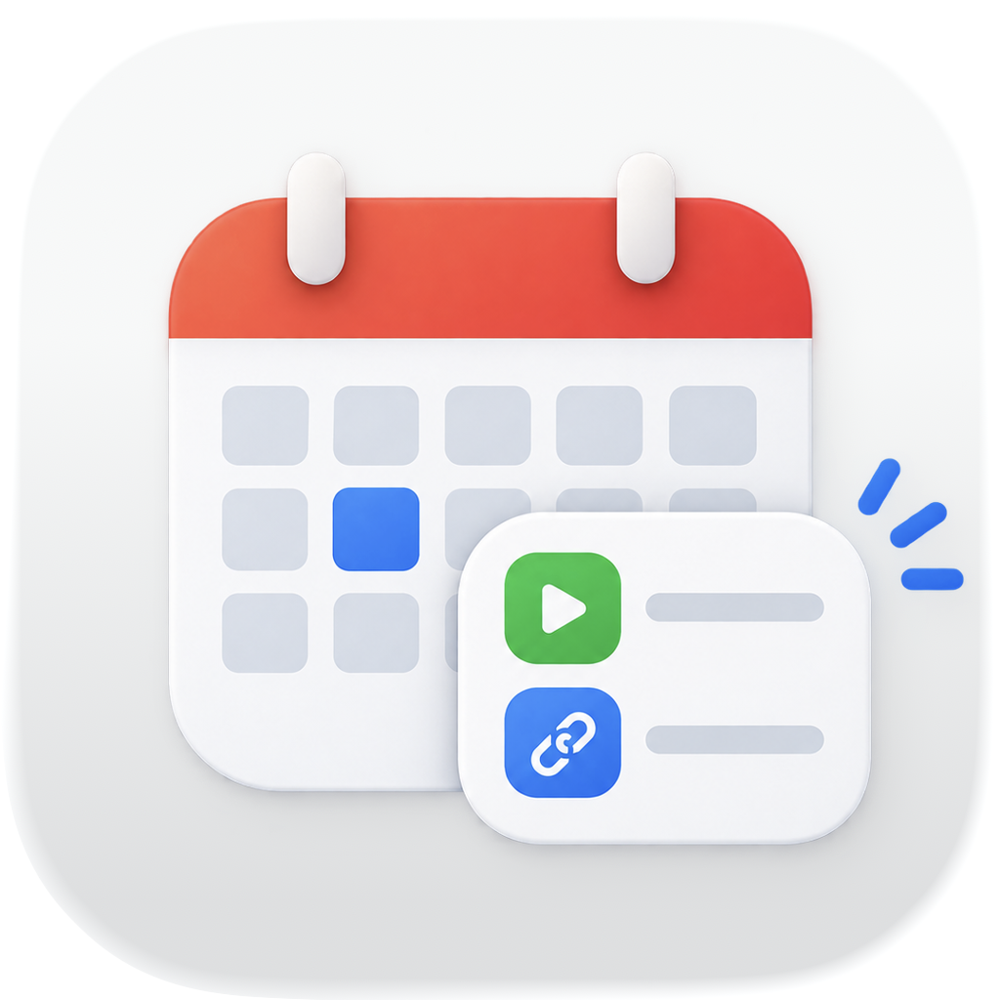

<p align="center">
  
</p>

# apple-calendar-custom-url

A minimal macOS app that adds your own meeting link — a personal Zoom room, a
standing Meet or Jitsi link, anything with a URL — to Apple Calendar's video
call options, next to FaceTime.

It does this with an
[`EKVirtualConferenceProvider`](https://developer.apple.com/documentation/eventkit/ekvirtualconferenceprovider)
extension. The app itself is a single settings window: a name for the entry,
the link, and optional details such as a passcode.

No third-party dependencies.

## Building

Requires Xcode 26, for the macOS 26 SDK; CI builds on macOS 26 too. Runs on
macOS 14 or later.

```bash
Scripts/build.sh && open build/CustomCalendarURL.app
```

The script compiles the SwiftPM targets, assembles `build/CustomCalendarURL.app` with
the extension embedded at `Contents/PlugIns/CustomCalendarURLExtension.appex`, and
ad-hoc signs both. The app icon is compiled with `actool` from
`Resources/CalendarCustomURL.icon`, an Icon Composer file.

## Using it

1. Move `CustomCalendarURL.app` to `/Applications` and open it once, so the system
   registers the extension.
2. Enter the link, and a name for it.
3. In Calendar, click an event's location field and pick that name from the
   video call options. Calendar fills in the link.

If the entry does not show up, quit and reopen Calendar, and check that the
extension is turned on in System Settings › General › Login Items &
Extensions. `pluginkit -m -p com.apple.calendar.virtualconference` lists what
the system has registered.

## How it fits together

| | |
| --- | --- |
| `Sources/CustomCalendarURLCore` | The settings keys, link parsing, and the descriptors handed to Calendar — shared by both targets |
| `Sources/CustomCalendarURL` | The settings app, and the `--selftest` suite |
| `Sources/CustomCalendarURLExtension` | The `EKVirtualConferenceProvider` subclass |
| `Resources/` | Both `Info.plist`s, the extension's entitlements, and the app icon |

The app writes its settings to its own defaults. Extensions must be
sandboxed, so the extension reads them through a read-only shared-preference
entitlement naming the app's bundle identifier; an App Group would do the
same but needs a signing team. Settings are read on every request, so a
changed link applies straight away.

## Testing

There is no XCTest bundle; the checks are built into the app binary, like in
[doctopus](https://github.com/jansim/doctopus).

```bash
Scripts/build.sh
build/CustomCalendarURL.app/Contents/MacOS/CustomCalendarURL --selftest
```

`--selftest` checks link parsing, the settings round-trip and everything the
extension answers Calendar with, and — run from the built app — that the
extension is embedded with the right extension point, class and identifiers.
CI additionally verifies the signatures and entitlements, and that `pluginkit`
accepts the extension.
